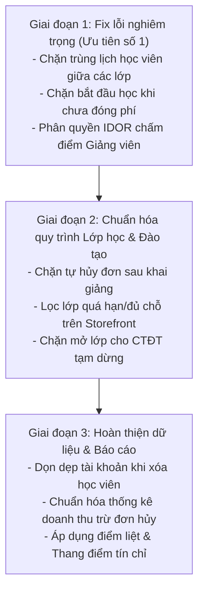

# BÁO CÁO TỔNG HỢP LỖI NGHIỆP VỤ & ĐỀ XUẤT NÂNG CẤP HỆ THỐNG
**Dự án:** Quản lý Khóa học & Cổng Đào tạo UNETI (`QuanLyKhoaHoc_UNETI4_DHTI17A1HN`)  
**Ngày báo cáo:** 12/11/2026  
**Mục đích:** Rà soát toàn bộ codebase các module (Module 1, 2, 3, 4, 5, Cổng học viên, Cổng giảng viên), phát hiện các mâu thuẫn dữ liệu, lỗ hổng phân quyền và lỗi logic nghiệp vụ để thống nhất kế hoạch hoàn thiện.

---

## 📌 BẢNG TỔNG HỢP MỨC ĐỘ ƯU TIÊN

| STT | Tên lỗi nghiệp vụ | Vị trí Module | Mức độ | Trạng thái hiện tại |
| :---: | :--- | :--- | :---: | :---: |
| **01** | **Đăng ký trùng thời khóa biểu giữa 2 lớp** | Module 4 & Cổng HV | 🔴 Nghiêm trọng | Chưa chặn trùng lịch khác lớp |
| **02** | **Cho vào học trực tiếp khi chưa nộp học phí** | Module 4 | 🔴 Nghiêm trọng | Cho phép đổi trạng thái tự do |
| **03** | **Lỗ hổng phân quyền chấm điểm Giảng viên (IDOR)** | Module 5 & Cổng GV | 🔴 Nghiêm trọng | Không kiểm tra quyền sở hữu lớp |
| **04** | **Mâu thuẫn điều kiện chấm điểm giữa Admin & GV** | Module 5 & Cổng GV | 🔴 Nghiêm trọng | GV chấm được khi chưa học xong |
| **05** | **Học viên tự hủy đăng ký sau ngày khai giảng** | Cổng HV & Module 4 | 🟡 Cảnh báo | Thiếu ràng buộc ngày khai giảng |
| **06** | **Lớp quá hạn/hết chỗ vẫn hiển thị tuyển sinh** | Cổng HV & Module 2 | 🟡 Cảnh báo | Thiếu bộ lọc hạn & chỗ trống |
| **07** | **Mở lớp cho Chương trình đào tạo đã Tạm dừng** | Module 1 & Module 2 | 🟡 Cảnh báo | Không kiểm tra trạng thái CTĐT |
| **08** | **Tài khoản rác (Orphaned Account) khi xóa học viên** | Module 1 & Module 3 | 🟡 Cảnh báo | Xóa bảng Học viên, giữ Tài khoản |
| **09** | **Doanh thu thống kê tính cả các đơn đã hủy/hoàn** | Module 5 & Thống kê | 🔵 Khuyến nghị | Thiếu điều kiện lọc trạng thái |
| **10** | **Điểm liệt và quy chế thang điểm tín chỉ UNETI** | Module 5 & Đào tạo | 🔵 Khuyến nghị | Thiếu điểm liệt, nhầm điểm D trượt |

---

## 🔴 CHI TIẾT CÁC LỖI NGHIỆP VỤ NGHIÊM TRỌNG

### 1. Đăng ký học trùng thời khóa biểu giữa 2 lớp khác nhau
* **File liên quan**: 
  * `Controllers/CongHocVienController.cs` (Dòng 240 - Action `DangKyLopPost`)
  * `Controllers/DangKyHocController.cs` (Dòng 185 - Action `Duyet`)
  * `Repositories/DangKyHocRepository.cs` (Dòng 197 - Hàm `HasEnrolledAsync`)
* **Hiện trạng code**:
  ```csharp
  // Hệ thống chỉ kiểm tra sinh viên đã đăng ký vào chính lớp này hay chưa:
  bool daDangKy = await _dangKyHocRepo.HasEnrolledAsync(student.MaHocVien, targetMaLop);
  if (daDangKy)
  {
      return Json(new { success = false, message = "Bạn đã có hồ sơ đăng ký cho khóa học này rồi." });
  }
  ```
* **Mâu thuẫn nghiệp vụ**:
  * Nếu sinh viên A đã được duyệt học Lớp Java (học Sáng Thứ 2: Ca 1 từ 07:00 – 09:15).
  * Sinh viên A tiếp tục đăng ký Lớp C# (cũng học đúng Sáng Thứ 2: Ca 1 từ 07:00 – 09:15).
  * Hệ thống vẫn cho đăng ký và Ban Giáo vụ vẫn bấm duyệt thành công! Sinh viên không thể có mặt tại 2 lớp cùng một thời điểm.
* **Đề xuất khắc phục**:
  * Viết thêm hàm `KiemTraTrungLichHocVienAsync(int maHocVien, int maLopMoi)` trong `DangKyHocRepository`.
  * Lấy danh sách các buổi học (`BuoiHoc`) của lớp mới dự định đăng ký, so khớp với tất cả các buổi học của các lớp mà học viên đang có trạng thái `Đã duyệt`, `Đã đóng học phí`, `Đang học`. Nếu trùng ngày và giao nhau về khung giờ thì chặn lại và thông báo trùng lịch.

---

### 2. Cho phép vào học trực tiếp khi chưa đóng học phí / chưa duyệt hồ sơ
* **File liên quan**: `Controllers/DangKyHocController.cs` (Dòng 281 – 299, Action `BatDauHocPost`)
* **Hiện trạng code**:
  ```csharp
  [HttpPost]
  [Route("DangKyHoc/BatDauHocPost")]
  public async Task<IActionResult> BatDauHocPost(int id)
  {
      var dk = await _dangKyHocRepo.GetByIdWithDetailsAsync(id);
      ...
      dk.TrangThai = "Đang học";
      await _dangKyHocRepo.UpdateAsync(dk);
      ...
  }
  ```
* **Mâu thuẫn nghiệp vụ**:
  * Action này không hề kiểm tra trạng thái trước đó của hồ sơ.
  * Giáo vụ có thể bấm chuyển một hồ sơ đang ở trạng thái `Chờ duyệt`, `Từ chối`, hoặc `Chờ xác nhận học phí` (chưa nộp đồng nào) sang thẳng `Đang học`.
* **Đề xuất khắc phục**:
  * Ràng buộc chặt chẽ: Chỉ cho phép chuyển sang `Đang học` khi hồ sơ đã ở trạng thái `Đã đóng học phí` (hoặc lớp miễn phí `HocPhi == 0` đã ở trạng thái `Đã duyệt`).

---

### 3. Lỗ hổng phân quyền Giảng viên (IDOR - Insecure Direct Object Reference)
* **File liên quan**: 
  * `Controllers/GiangVienController.cs` (Dòng 120 – 180, Actions `ChamDiem`, `LuuDiemAjax`)
  * `Repositories/GiangVienRepository.cs` (Dòng 178 – 238, Hàm `SaveGradeAsync`)
* **Hiện trạng code**:
  ```csharp
  // Action ChamDiem nhận maLop trực tiếp từ URL query:
  public async Task<IActionResult> ChamDiem(int? maLop, int? maGiangVien = null)

  // SaveGradeAsync chỉ tìm maDangKy và cập nhật điểm trực tiếp:
  var dk = await _context.DangKyHocs.FirstOrDefaultAsync(d => d.MaDangKy == maDangKy);
  ```
* **Mâu thuẫn nghiệp vụ**:
  * Hệ thống không kiểm tra xem lớp học (`MaLopHoc`) hoặc hồ sơ đăng ký (`MaDangKy`) có thực sự do chính giảng viên đang đăng nhập phụ trách hay không.
  * Giảng viên A có thể gõ `?maLop=...` của lớp Giảng viên B trên thanh địa chỉ hoặc gửi AJAX `LuuDiemAjax` với `maDangKy` bất kỳ để xem và sửa đổi điểm số của sinh viên lớp khác.
* **Đề xuất khắc phục**:
  * Trong `ChamDiem`: Kiểm tra `if (currentClass != null && currentClass.MaGiangVien != gv.MaGiangVien) return Forbid();`
  * Trong `SaveGradeAsync`: Đối chiếu `dk.LopHoc.MaGiangVien == maGiangVienHienTai`.

---

### 4. Mâu thuẫn điều kiện chấm điểm giữa Admin/Giáo vụ và Cổng Giảng viên
* **File liên quan**:
  * `Controllers/KetQuaHocTapController.cs` (Dòng 144 – 148, Action `Create`)
  * `Controllers/GiangVienController.cs` & `Repositories/GiangVienRepository.cs` (Hàm `SaveGradeAsync`)
* **Hiện trạng code**:
  * Tại `KetQuaHocTapController.cs` (Phía Admin/Giáo vụ): Bắt buộc kiểm tra toàn bộ buổi học của lớp phải có trạng thái `Đã hoàn thành`:
    ```csharp
    if (classSessions.Any(b => b.TrangThai != "Đã hoàn thành"))
    {
        ModelState.AddModelError("", "Lớp học vẫn còn buổi học chưa hoàn thành. Chỉ khi toàn bộ buổi học đã hoàn thành mới được ghi nhận điểm cuối khóa.");
    }
    ```
  * Nhưng tại Cổng Giảng viên: Giảng viên vào form chấm điểm và bấm lưu điểm lúc nào cũng được, kể cả khi lớp vừa mới mở chưa học buổi nào!
* **Mâu thuẫn nghiệp vụ**: Quy chế đào tạo không đồng nhất giữa hai phân hệ quản lý.
* **Đề xuất khắc phục**: Thống nhất quy định: Cả Giảng viên và Giáo vụ chỉ được chốt điểm và cấp trạng thái Hoàn thành khóa học khi số buổi học đã hoàn thành đạt 100%.

---

## 🟡 CÁC LỖI QUY TRÌNH & DỮ LIỆU KHÔNG NHẤT QUÁN

### 5. Học viên được phép tự hủy đăng ký sau khi lớp đã khai giảng
* **File liên quan**: `Controllers/CongHocVienController.cs` (Dòng 290 – 295, Action `HuyDangKyPost`)
* **Hiện trạng code**:
  ```csharp
  if (dk.TrangThai != "Chờ duyệt" && !(dk.TrangThai == "Đã duyệt" && dk.SoTienDaDong == 0))
  {
      return Json(new { success = false, message = "Không thể tự hủy đơn..." });
  }
  ```
* **Mâu thuẫn nghiệp vụ**:
  * Điều kiện trên chỉ kiểm tra trạng thái và số tiền đã đóng, **hoàn toàn không kiểm tra ngày khai giảng của lớp** (`lop.NgayKhaiGiang`).
  * Kể cả khi lớp đã khai giảng nhiều ngày, nếu sinh viên chưa nộp tiền thì vẫn có thể tự hủy ngang trên portal cá nhân, phá vỡ kế hoạch tổ chức lớp của trung tâm.
* **Đề xuất khắc phục**:
  * Bổ sung điều kiện: `DateTime.Today < lop.NgayKhaiGiang` (hoặc trước ngày khai giảng ít nhất 1 ngày). Khi lớp đã đến hoặc qua ngày khai giảng, sinh viên bắt buộc phải liên hệ Ban Giáo vụ.

---

### 6. Lớp học quá hạn hoặc đủ chỗ vẫn hiển thị tuyển sinh trên Marketplace
* **File liên quan**: `Controllers/CongHocVienController.cs` (Dòng 99 – 120, Action `DangKy`)
* **Hiện trạng code**:
  ```csharp
  var (classes, totalItems) = await _lopHocRepo.GetPagedAsync(
      search, maChuongTrinh, trinhDo, "Đang mở đăng ký", null, minHocPhi, maxHocPhi,
      null, // filterHanDangKy = null
      null, // filterConCho = null
      sortBy, page, pageSize);
  ```
* **Mâu thuẫn nghiệp vụ**:
  * Các lớp có `HanDangKy < DateTime.Today` hoặc sĩ số đã đầy nhưng trạng thái trong cơ sở dữ liệu chưa được nhân viên cập nhật thủ công thì vẫn xuất hiện trên trang tuyển sinh. Học viên bấm vào xem và đăng ký mới bị văng ra thông báo lỗi.
* **Đề xuất khắc phục**:
  * Mặc định áp dụng bộ lọc `filterHanDangKy = "con_han"` và `filterConCho = "con_cho"` trên Storefront Cổng học viên, hoặc hiển thị huy hiệu `Đã đủ chỗ` / `Đã hết hạn đăng ký` và khóa nút đăng ký ngay trên giao diện.

---

### 7. Cho phép tạo lớp học thuộc Chương trình đào tạo đã Tạm dừng
* **File liên quan**: `Controllers/LopHocController.cs` (Dòng 193 – 207, Action `CreatePost`)
* **Hiện trạng code**:
  * Khi tạo lớp học mới, hệ thống chỉ lưu `lop.MaChuongTrinh` mà không kiểm tra xem chương trình đào tạo đó có đang hoạt động (`TrangThai == true`) hay không.
* **Mâu thuẫn nghiệp vụ**: Khi nhà trường đã ra quyết định tạm dừng tuyển sinh một chuyên ngành/chương trình đào tạo, nhân viên vẫn vô tình mở thêm các lớp học mới cho chương trình đó.
* **Đề xuất khắc phục**: Bổ sung validation: Kiểm tra `ctdt.TrangThai == true` trước khi tạo hoặc chỉnh sửa lớp học.

---

### 8. Lỗi tài khoản rác (Orphaned Account) khi xóa học viên
* **File liên quan**: `Repositories/HocVienRepository.cs` (Dòng 83 – 91, Hàm `DeleteAsync`)
* **Hiện trạng code**:
  ```csharp
  var hocVien = await _context.HocViens.FindAsync(id);
  if (hocVien != null)
  {
      _context.HocViens.Remove(hocVien);
      await _context.SaveChangesAsync();
  }
  ```
* **Mâu thuẫn nghiệp vụ**:
  * Khi xóa một học viên, chỉ có dòng dữ liệu trong bảng `HocViens` bị xóa. Tài khoản đăng nhập tương ứng trong bảng `TaiKhoans` vẫn tồn tại nguyên vẹn.
  * Người dùng vẫn có thể đăng nhập bằng tài khoản này, nhưng khi truy cập vào hệ thống Cổng học viên sẽ bị lỗi do không tìm thấy `HocVien` liên kết.
* **Đề xuất khắc phục**: Khi xóa học viên, đồng thời xóa hoặc vô hiệu hóa (`TrangThai = false`) tài khoản `TaiKhoan` liên kết.

---

## 🔵 CHUẨN HÓA QUY CHẾ ĐÀO TẠO & THỐNG KÊ DOANH THU

### 9. Thống kê doanh thu tính cả các hồ sơ Đã hủy / Đã từ chối
* **File liên quan**: `Repositories/ThongKeRepository.cs` (Dòng 42 – 44, 106, 120)
* **Hiện trạng code**:
  ```csharp
  decimal tongDoanhThu = await _context.DangKyHocs
      .Where(d => d.NgayDongHocPhi != null)
      .SumAsync(d => (decimal?)d.SoTienDaDong) ?? 0m;
  ```
* **Mâu thuẫn nghiệp vụ**:
  * Khi sinh viên đã đóng học phí nhưng sau đó xin rút hồ sơ hoặc bị hủy lớp (`TrangThai == "Đã hủy"`), trường `NgayDongHocPhi` vẫn còn lưu ngày nộp.
  * Do đó, tổng doanh thu trên Dashboard và biểu đồ doanh thu theo tháng vẫn cộng cả tiền của các đơn đã hủy/hoàn trả, làm số liệu tài chính bị sai lệch.
* **Đề xuất khắc phục**: Bổ sung điều kiện loại trừ:
  ```csharp
  .Where(d => d.NgayDongHocPhi != null && d.TrangThai != "Đã hủy" && d.TrangThai != "Từ chối")
  ```

---

### 10. Xử lý điểm liệt và thang điểm tín chỉ chuẩn UNETI
* **File liên quan**: 
  * `Repositories/GiangVienRepository.cs` (Dòng 225 – 233)
  * `Controllers/KetQuaHocTapController.cs` (Dòng 162)
* **Hiện trạng code**:
  ```csharp
  // Tính điểm tổng kết: 40% Quá trình + 60% Cuối kỳ
  ketQua.DiemTongKet = Math.Round(diemQuaTrinh.Value * 0.4 + diemCK.Value * 0.6, 2);
  ketQua.KetQua = ketQua.DiemTongKet >= 5.0 ? "Hoàn thành" : "Không hoàn thành";
  ```
* **Mâu thuẫn nghiệp vụ**:
  1. **Không có quy chế điểm liệt**: Nếu sinh viên có điểm quá trình = 10, nhưng thi cuối kỳ được 2.0 điểm (bỏ thi hoặc trượt), điểm tổng kết = $(10 \times 0.4) + (2 \times 0.6) = 5.2 \ge 5.0$ $\rightarrow$ Hệ thống vẫn đánh giá là `"Hoàn thành"` (ĐẠT). Điều này trái với quy chế thi của trường đại học (điểm thi dưới 4.0 là điểm liệt).
  2. **Xếp loại điểm D**: Trong hệ thống tín chỉ, điểm D (từ 4.0 đến 4.9) là mức ĐẠT trung bình yếu để tích lũy học phần, chỉ có điểm F (< 4.0) mới là Không đạt. Hiện code đang coi điểm < 5.0 là Không hoàn thành.
* **Đề xuất khắc phục**:
  * Kiểm tra điểm liệt: Nếu `diemCK < 4.0` thì tự động xếp loại `Không hoàn thành` (Điểm F) bất kể điểm tổng kết.
  * Điểm tổng kết từ 4.0 trở lên (nếu không dính điểm liệt) là Đạt.

---

## 📋 ĐỀ XUẤT LỘ TRÌNH TRIỂN KHAI SỬA LỖI



---
*Báo cáo được biên soạn tự động phục vụ thảo luận nhóm phát triển dự án.*
