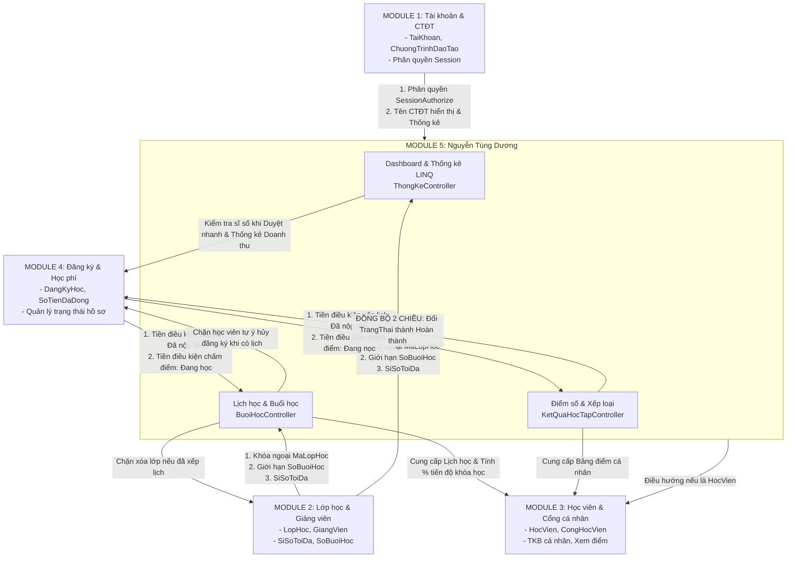

# CẨM NANG TOÀN DIỆN MODULE 5 & BẢN ĐỒ LIÊN KẾT HỆ THỐNG
> **Họ và tên:** Nguyễn Tùng Dương  
> **Mã sinh viên:** 23103100003  
> **Đề tài:** Quản lý đăng ký khóa học và học viên trung tâm đào tạo (Đề tài 36 - ASP.NET Core 10 MVC)  
> **Module đảm nhiệm:** Module 5 – Quản lý Lịch học & Buổi học, Kết quả học tập & Điểm số, Báo cáo Thống kê LINQ & Dashboard điều hành.

---

## MỤC LỤC TỔNG THỂ

1. [Sơ đồ Ma trận Liên kết giữa Module 5 và các Module 1, 2, 3, 4](#1-ma-tran-lien-ket)
2. [PHẦN I: THỰC THỂ DỮ LIỆU & RÀNG BUỘC TOÀN VẸN (ENTITIES)](#phan-1)
   - [Chức năng 1: Thực thể Buổi học (`BuoiHoc`)](#chuc-nang-1)
   - [Chức năng 2: Thực thể Kết quả học tập (`KetQuaHocTap`)](#chuc-nang-2)
3. [PHẦN II: PHÂN HỆ QUẢN LÝ LỊCH HỌC & BUỔI HỌC (`BuoiHoc`)](#phan-2)
   - [Chức năng 3: Hiển thị Thời khóa biểu tuần & Danh sách buổi học (`Index`)](#chuc-nang-3)
   - [Chức năng 4: Xếp lịch học mới & 4 tầng kiểm tra ràng buộc (`Create`)](#chuc-nang-4)
   - [Chức năng 5: Chỉnh sửa buổi học qua Slide-over Drawer (`EditPost`)](#chuc-nang-5)
   - [Chức năng 6: Đánh dấu Hoàn thành sau ca học (`HoanThanh`)](#chuc-nang-6)
   - [Chức năng 7: Hủy ca học (`Huy`) và Xóa vĩnh viễn (`DeletePost`)](#chuc-nang-7)
   - [Chức năng 8: Các Module khác gọi Module 5 để bảo vệ tính toàn vẹn](#chuc-nang-8)
4. [PHẦN III: PHÂN HỆ KẾT QUẢ HỌC TẬP & ĐIỂM SỐ (`KetQuaHocTap`)](#phan-3)
   - [Chức năng 9: Bảng điểm, Phổ điểm 5 bậc & Thống kê Tỷ lệ hoàn thành (`Index`)](#chuc-nang-9)
   - [Chức năng 10: Nhập điểm mới & 2 điều kiện tiên quyết (`Create`)](#chuc-nang-10)
   - [Chức năng 11: Cơ chế Đồng bộ Tự động 2 chiều sang `DangKyHoc`](#chuc-nang-11)
   - [Chức năng 12: Chỉnh sửa điểm số & Xóa kết quả (`EditPost` & `DeletePost`)](#chuc-nang-12)
   - [Chức năng 13: Cổng học viên xem Bảng điểm cá nhân (Module 3 gọi Module 5)](#chuc-nang-13)
5. [PHẦN IV: PHÂN HỆ DASHBOARD & BÁO CÁO THỐNG KÊ LINQ (`ThongKe`)](#phan-4)
   - [Chức năng 14: Dashboard Điều hành trung tâm (`Dashboard`)](#chuc-nang-14)
   - [Chức năng 15: Duyệt nhanh hồ sơ đăng ký tại Dashboard (`DuyetNhanh`)](#chuc-nang-15)
   - [Chức năng 16: Báo cáo Thống kê LINQ nâng cao (`Index` - 11 chỉ số & Top GV)](#chuc-nang-16)

---

<a name="1-ma-tran-lien-ket"></a>
## 1. SƠ ĐỒ MA TRẬN LIÊN KẾT GIỮA MODULE 5 VÀ CÁC MODULE 1, 2, 3, 4

Module 5 đóng vai trò là **"Trung tâm điều phối & Đánh giá"** của toàn hệ sinh thái phần mềm:



---

<a name="phan-1"></a>
## PHẦN I: THỰC THỂ DỮ LIỆU & RÀNG BUỘC TOÀN VẸN (ENTITIES)

<a name="chuc-nang-1"></a>
### Chức năng 1: Thực thể Buổi học ([`BuoiHoc.cs`](file:///c:/Users/ADMIN/Desktop/.NET/THLT%20.NET/duan36.1/QuanLyKhoaHoc_UNETI4_DHTI17A1HN/Models/BuoiHoc.cs))

#### 1. Ý nghĩa & Nghiệp vụ
Quản lý từng ca học cụ thể của một lớp học: thời gian bắt đầu, kết thúc, phòng học máy tính, giảng viên đứng lớp, nội dung bài giảng và trạng thái (`Đã lên lịch`, `Đã hoàn thành`, `Đã hủy`).

#### 2. Phân tích Liên kết với các Module khác
- **Liên kết Module 2 (`LopHoc`):** `BuoiHoc` quan hệ nhiều-một ($N-1$) với `LopHoc` thông qua khóa ngoại `MaLopHoc`.
- **Liên kết Module 1 (`ChuongTrinhDaoTao`):** Gián tiếp thông qua `LopHoc.MaChuongTrinh` để lấy tên khóa học hiển thị lên lịch biểu.

#### 3. Mã nguồn triển khai
```csharp
namespace QuanLyKhoaHoc_UNETI4_DHTI17A1HN.Models
{
    public class BuoiHoc
    {
        [Key]
        public int MaBuoiHoc { get; set; }

        [Required(ErrorMessage = "Vui lòng chọn lớp học")]
        public int MaLopHoc { get; set; } // Khóa ngoại liên kết Module 2

        [Required(ErrorMessage = "Vui lòng chọn thời gian bắt đầu")]
        public DateTime ThoiGianBatDau { get; set; }

        [Required(ErrorMessage = "Vui lòng chọn thời gian kết thúc")]
        public DateTime ThoiGianKetThuc { get; set; }

        [Required(ErrorMessage = "Vui lòng nhập phòng học")]
        [StringLength(50)]
        public string PhongHoc { get; set; }

        [Required(ErrorMessage = "Vui lòng nhập tên giảng viên")]
        [StringLength(100)]
        public string GiangVien { get; set; }

        public string? NoiDung { get; set; }
        public string? GhiChu { get; set; }

        [Required]
        [StringLength(50)]
        public string TrangThai { get; set; } = "Đã lên lịch"; // Đã lên lịch, Đã hoàn thành, Đã hủy

        [ForeignKey("MaLopHoc")]
        public virtual LopHoc? LopHoc { get; set; }
    }
}
```

---

<a name="chuc-nang-2"></a>
### Chức năng 2: Thực thể Kết quả học tập ([`KetQuaHocTap.cs`](file:///c:/Users/ADMIN/Desktop/.NET/THLT%20.NET/duan36.1/QuanLyKhoaHoc_UNETI4_DHTI17A1HN/Models/KetQuaHocTap.cs))

#### 1. Ý nghĩa & Nghiệp vụ
Lưu trữ bảng điểm tổng kết của một học viên cho một lần đăng ký lớp học: Điểm chuyên cần (30%), Điểm cuối khóa (70%), Điểm tổng kết tự động tính, Đánh giá kết quả (`Hoàn thành`, `Không hoàn thành`) và nhận xét của giảng viên.

#### 2. Phân tích Liên kết với các Module khác
- **Liên kết Module 4 (`DangKyHoc`):** `KetQuaHocTap` quan hệ một-một ($1-1$) với `DangKyHoc` qua `MaDangKy`.
- **Liên kết Module 3 (`HocVien`) & Module 2 (`LopHoc`):** Thông qua `DangKyHoc` để truy xuất danh tính sinh viên và thông tin lớp học.

#### 3. Mã nguồn triển khai
```csharp
namespace QuanLyKhoaHoc_UNETI4_DHTI17A1HN.Models
{
    public class KetQuaHocTap
    {
        [Key]
        public int MaKetQua { get; set; }

        [Required]
        public int MaDangKy { get; set; } // Khóa ngoại liên kết Module 4

        [Range(0, 10, ErrorMessage = "Điểm chuyên cần phải từ 0 đến 10")]
        public double DiemChuyenCan { get; set; }

        [Range(0, 10, ErrorMessage = "Điểm cuối khóa phải từ 0 đến 10")]
        public double DiemCuoiKhoa { get; set; }

        public double DiemTongKet { get; set; }

        [Required]
        [StringLength(50)]
        public string KetQua { get; set; } = "Chưa hoàn thành"; // Hoàn thành, Không hoàn thành

        public string? NhanXet { get; set; }
        public DateTime NgayCapNhat { get; set; }

        [ForeignKey("MaDangKy")]
        public virtual DangKyHoc? DangKyHoc { get; set; }
    }
}
```

---

<a name="phan-2"></a>
## PHẦN II: PHÂN HỆ QUẢN LÝ LỊCH HỌC & BUỔI HỌC (`BuoiHoc`)

<a name="chuc-nang-3"></a>
### Chức năng 3: Hiển thị Thời khóa biểu tuần & Danh sách buổi học (`Index`)

#### 1. Ý nghĩa & Nghiệp vụ
Cho phép Giáo vụ và Quản trị viên theo dõi lịch học toàn trung tâm theo 2 góc nhìn:
- **Dạng bảng CRUD truyền thống:** Hỗ trợ tìm kiếm, lọc theo mã lớp, phòng học, trạng thái, phân trang cố định 8 bản ghi/trang.
- **Dạng Ma trận Thời khóa biểu tuần trực quan:** Ma trận 6 ngày (Thứ 2 $\rightarrow$ Thứ 7) $\times$ 4 ca học chuẩn:
  - *Ca 1 (Sáng):* `07:00 - 09:15` | *Ca 2 (Sáng):* `09:30 - 11:45`
  - *Ca 3 (Chiều):* `13:30 - 15:45` | *Ca 4 (Chiều):* `16:00 - 18:15`
- **Thuật toán quét xung đột toàn hệ thống $O(N^2)$:** Quét toàn bộ các ca học chưa hủy, tìm các cặp vi phạm cùng phòng/GV/lớp giao nhau thời gian và đánh dấu badge đỏ `⚠️ Trùng lịch` trên giao diện.

#### 2. Phân tích Liên kết với các Module khác
- **Liên kết Module 1 (`TaiKhoan`):** Đọc `Session["VaiTro"]`. Nếu người truy cập là `HocVien`, lập tức điều hướng sang `CongHocVien/TienTrinh?tab=tkb` (Module 3) để bảo vệ dữ liệu nội bộ.
- **Liên kết Module 2 (`LopHoc`):** Nạp dropdown `ViewBag.LopHocList` và danh sách giảng viên `ViewBag.DanhSachGiangVien`.
- **Liên kết Module 1 (`ChuongTrinhDaoTao`):** Sử dụng Eager Loading:
  `.Include(b => b.LopHoc).ThenInclude(l => l.ChuongTrinhDaoTao)` để hiển thị tên môn học trên thẻ lịch.

#### 3. Mã nguồn triển khai
Trong [`BuoiHocController.cs`](file:///c:/Users/ADMIN/Desktop/.NET/THLT%20.NET/duan36.1/QuanLyKhoaHoc_UNETI4_DHTI17A1HN/Controllers/BuoiHocController.cs#L36-L94):
```csharp
[SessionAuthorize("Admin", "GiaoVu")] // Liên kết Module 1 (Bảo mật Session)
public async Task<IActionResult> Index(int? maLop, string? phong, string? trangThai, string? search, int page = 1)
{
    // LIÊN KẾT MODULE 3: Nếu học viên truy cập nhầm -> Chuyển hướng sang Cổng học viên
    var vaiTro = HttpContext.Session.GetString("VaiTro");
    if (string.Equals(vaiTro, "HocVien", StringComparison.OrdinalIgnoreCase))
    {
        return RedirectToAction("TienTrinh", "CongHocVien", new { tab = "tkb" });
    }

    int pageSize = 8;

    // 1. Thuật toán quét xung đột trùng lịch
    var (conflictIds, soLoiTrung) = await _buoiHocRepo.GetConflictSessionsAsync();
    ViewBag.ConflictIds = conflictIds;
    ViewBag.SoLoiTrung = soLoiTrung;

    // 2. Phân trang & Lọc LINQ
    var (buoiHocs, totalRecords) = await _buoiHocRepo.GetPagedAsync(search, maLop, phong, trangThai, null, null, "thoigian_desc", page, pageSize);

    // 3. LIÊN KẾT MODULE 2: Nạp dữ liệu lớp học & giảng viên
    ViewBag.LopHocList = await _lopHocRepo.GetAllAsync();
    var allSessions = await _buoiHocRepo.GetAllAsync();
    ViewBag.AllBuoiHocs = allSessions;
    ViewBag.DanhSachPhong = allSessions.Select(b => b.PhongHoc).Where(p => !string.IsNullOrEmpty(p)).Distinct().ToList();
    ViewBag.DanhSachGiangVien = allSessions.Select(b => b.GiangVien).Where(g => !string.IsNullOrEmpty(g)).Distinct().ToList();

    return View(buoiHocs);
}
```

Thuật toán quét xung đột trong [`BuoiHocRepository.cs`](file:///c:/Users/ADMIN/Desktop/.NET/THLT%20.NET/duan36.1/QuanLyKhoaHoc_UNETI4_DHTI17A1HN/Repositories/BuoiHocRepository.cs#L215-L235):
```csharp
public async Task<(HashSet<int> ConflictIds, int SoLoiTrung)> GetConflictSessionsAsync()
{
    var allActive = await _context.BuoiHocs.Where(b => b.TrangThai != "Đã hủy").ToListAsync();
    var conflictIds = new HashSet<int>();
    for (int i = 0; i < allActive.Count; i++)
    {
        for (int j = i + 1; j < allActive.Count; j++)
        {
            var b1 = allActive[i];
            var b2 = allActive[j];
            if ((b1.PhongHoc == b2.PhongHoc || b1.GiangVien == b2.GiangVien || b1.MaLopHoc == b2.MaLopHoc) &&
                (b1.ThoiGianBatDau < b2.ThoiGianKetThuc && b1.ThoiGianKetThuc > b2.ThoiGianBatDau))
            {
                conflictIds.Add(b1.MaBuoiHoc);
                conflictIds.Add(b2.MaBuoiHoc);
            }
        }
    }
    return (conflictIds, conflictIds.Count);
}
```

---

<a name="chuc-nang-4"></a>
### Chức năng 4: Xếp lịch học mới & 4 tầng kiểm tra ràng buộc (`Create`)

#### 1. Ý nghĩa & Nghiệp vụ
Thực hiện thêm một ca học mới vào hệ thống. Trước khi bản ghi được `INSERT` vào CSDL, hệ thống buộc phải vượt qua 4 tầng kiểm tra ràng buộc nghiệp vụ theo yêu cầu Mục 9.2 của đề tài.

#### 2. Phân tích Liên kết với các Module khác
- **Liên kết Module 4 (`DangKyHoc`):** Gọi `_dangKyHocRepo.CountEnrolledInLopAsync` $\rightarrow$ Chỉ khi lớp có ít nhất 1 học viên đã đóng tiền hoặc được duyệt mới được mở lịch.
- **Liên kết Module 2 (`LopHoc`):** Gọi `_lopHocRepo.GetByIdAsync` $\rightarrow$ Đọc trường `SoBuoiHoc` để khống chế tổng số ca học của lớp không vượt quy định.
- **Kiểm tra trùng tài nguyên:** Chống trùng với phòng học, giảng viên (Module 2) và lớp học.

#### 3. Mã nguồn triển khai
Trong [`BuoiHocController.cs`](file:///c:/Users/ADMIN/Desktop/.NET/THLT%20.NET/duan36.1/QuanLyKhoaHoc_UNETI4_DHTI17A1HN/Controllers/BuoiHocController.cs#L104-L170):
```csharp
[HttpPost]
[ValidateAntiForgeryToken]
public async Task<IActionResult> Create(BuoiHoc buoiHoc)
{
    ModelState.Remove("LopHoc");
    bool isAjax = Request.Headers["X-Requested-With"] == "XMLHttpRequest";

    // 1. LIÊN KẾT MODULE 4: Kiểm tra lớp đã có học viên đóng tiền/được duyệt chưa?
    int currentEnrolled = await _dangKyHocRepo.CountEnrolledInLopAsync(buoiHoc.MaLopHoc);
    if (currentEnrolled == 0)
    {
        ModelState.AddModelError("", "Lớp này chưa có học viên nào được duyệt hoặc đóng học phí, không được xếp lịch.");
    }

    // 2. KIỂM TRA THỜI GIAN: Không lùi về quá khứ, giờ kết thúc > bắt đầu
    if (buoiHoc.ThoiGianBatDau < DateTime.Now)
    {
        ModelState.AddModelError("ThoiGianBatDau", "Thời gian học không được nằm trong quá khứ tại thời điểm xếp lịch.");
    }
    if (buoiHoc.ThoiGianKetThuc <= buoiHoc.ThoiGianBatDau)
    {
        ModelState.AddModelError("ThoiGianKetThuc", "Thời gian kết thúc phải sau thời gian bắt đầu.");
    }

    // 3. LIÊN KẾT MODULE 2: Kiểm tra số buổi học vượt quy định của môn
    var lopHoc = await _lopHocRepo.GetByIdAsync(buoiHoc.MaLopHoc);
    if (lopHoc != null)
    {
        int soBuoiChuaHuy = await _buoiHocRepo.CountBuoiHocChuaHuyAsync(buoiHoc.MaLopHoc);
        if (soBuoiChuaHuy >= lopHoc.SoBuoiHoc)
        {
            ModelState.AddModelError("", $"Lớp này đã xếp đủ {lopHoc.SoBuoiHoc} buổi học theo quy định.");
        }
    }

    // 4. KIỂM TRA TRÙNG LỊCH BẰNG LINQ: Phòng, Giảng viên, Lớp trong khung giờ
    bool isTrungLich = await _buoiHocRepo.KiemTraTrungLichBuoiHocAsync(
        buoiHoc.MaLopHoc, buoiHoc.PhongHoc, buoiHoc.GiangVien, buoiHoc.ThoiGianBatDau, buoiHoc.ThoiGianKetThuc);
    if (isTrungLich)
    {
        ModelState.AddModelError("", "Lịch bị trùng! Kiểm tra lại Giảng viên, Phòng học hoặc Lớp đã có lịch trong khung giờ này.");
    }

    // NẾU HỢP LỆ -> LƯU CƠ SỞ DỮ LIỆU
    if (ModelState.IsValid)
    {
        if (string.IsNullOrEmpty(buoiHoc.TrangThai)) buoiHoc.TrangThai = "Đã lên lịch";
        await _buoiHocRepo.AddAsync(buoiHoc);
        if (isAjax) return Json(new { success = true, message = "Xếp lịch học thành công!" });
        TempData["Success"] = "Xếp lịch học thành công!";
        return RedirectToAction(nameof(Index));
    }

    string errorMsg = string.Join("; ", ModelState.Values.SelectMany(v => v.Errors).Select(e => e.ErrorMessage));
    if (isAjax) return Json(new { success = false, message = errorMsg });
    TempData["Error"] = errorMsg;
    return RedirectToAction(nameof(Index));
}
```

---

<a name="chuc-nang-5"></a>
### Chức năng 5: Chỉnh sửa buổi học qua Slide-over Drawer (`EditPost`)

#### 1. Ý nghĩa & Nghiệp vụ
Cho phép giáo vụ chỉnh sửa thông tin ca học (đổi phòng máy, phân công lại giảng viên, đổi giờ học, ghi chú) ngay từ Slide-over Drawer bên phải màn hình mà không cần chuyển trang.

#### 2. Phân tích Liên kết với các Module khác
- **Liên kết Module 2 (`LopHoc`, `GiangVien`):** Khi đổi giảng viên hoặc phòng, hệ thống kiểm tra xung đột với lịch dạy của giảng viên đó từ Module 2.
- **Ràng buộc loại trừ chính nó (`excludeId`):** Khi kiểm tra trùng lịch, phải loại trừ chính `MaBuoiHoc` đang chỉnh sửa (`b.MaBuoiHoc != excludeId`).

#### 3. Mã nguồn triển khai
Trong [`BuoiHocController.cs`](file:///c:/Users/ADMIN/Desktop/.NET/THLT%20.NET/duan36.1/QuanLyKhoaHoc_UNETI4_DHTI17A1HN/Controllers/BuoiHocController.cs#L173-L225):
```csharp
[HttpPost]
[ValidateAntiForgeryToken]
public async Task<IActionResult> EditPost(BuoiHoc buoiHoc)
{
    ModelState.Remove("LopHoc");
    bool isAjax = Request.Headers["X-Requested-With"] == "XMLHttpRequest";

    var existing = await _buoiHocRepo.GetByIdAsync(buoiHoc.MaBuoiHoc);
    if (existing == null)
        return isAjax ? Json(new { success = false, message = "Không tìm thấy buổi học." }) : NotFound();

    // Kiểm tra trùng lịch loại trừ chính nó (excludeId = buoiHoc.MaBuoiHoc)
    bool isTrungLich = await _buoiHocRepo.KiemTraTrungLichBuoiHocAsync(
        buoiHoc.MaLopHoc, buoiHoc.PhongHoc, buoiHoc.GiangVien, buoiHoc.ThoiGianBatDau, buoiHoc.ThoiGianKetThuc, buoiHoc.MaBuoiHoc);

    if (isTrungLich)
    {
        string msg = "Cập nhật thất bại: Trùng lịch với ca học khác (trùng phòng, giảng viên hoặc lớp)!";
        if (isAjax) return Json(new { success = false, message = msg });
        TempData["Error"] = msg;
        return RedirectToAction(nameof(Index));
    }

    existing.MaLopHoc = buoiHoc.MaLopHoc;
    existing.PhongHoc = buoiHoc.PhongHoc;
    existing.GiangVien = buoiHoc.GiangVien;
    existing.ThoiGianBatDau = buoiHoc.ThoiGianBatDau;
    existing.ThoiGianKetThuc = buoiHoc.ThoiGianKetThuc;
    existing.NoiDung = buoiHoc.NoiDung;
    existing.GhiChu = buoiHoc.GhiChu;
    existing.TrangThai = buoiHoc.TrangThai ?? existing.TrangThai;

    await _buoiHocRepo.UpdateAsync(existing);
    if (isAjax) return Json(new { success = true, message = "Cập nhật buổi học thành công!" });
    TempData["Success"] = "Cập nhật buổi học thành công!";
    return RedirectToAction(nameof(Index));
}
```

---

<a name="chuc-nang-6"></a>
### Chức năng 6: Đánh dấu Hoàn thành sau ca học (`HoanThanh`)

#### 1. Ý nghĩa & Nghiệp vụ
Khi một buổi học kết thúc trên thực tế, giáo vụ hoặc giảng viên bấm nút "Đánh dấu hoàn thành". Hệ thống chuyển trạng thái ca học thành `Đã hoàn thành`.

#### 2. Phân tích Liên kết với các Module khác
- **Liên kết Module 3 (`CongHocVien`):** Khi ca học chuyển sang `Đã hoàn thành`, thanh tiến độ khóa học bên Cổng học viên sẽ tăng lên:
  $$\text{Tiến độ (\%)} = \frac{\text{Số buổi đã hoàn thành}}{\text{Tổng số buổi của lớp}} \times 100$$
- **Liên kết Module 5 (Chức năng nhập điểm `KetQuaHocTap`):** Đây là điều kiện tiên quyết để mở khóa chức năng nhập điểm thi cuối khóa. Lớp học bắt buộc phải hoàn thành 100% buổi học thì mới được chấm điểm.
- **Quy tắc chống gian lận:** Ca học bắt buộc phải có `ThoiGianKetThuc <= DateTime.Now` (đã diễn ra xong trên thực tế) mới được xác nhận.

#### 3. Mã nguồn triển khai
Trong [`BuoiHocController.cs`](file:///c:/Users/ADMIN/Desktop/.NET/THLT%20.NET/duan36.1/QuanLyKhoaHoc_UNETI4_DHTI17A1HN/Controllers/BuoiHocController.cs#L250-L280):
```csharp
[HttpPost]
public async Task<IActionResult> HoanThanh(int id)
{
    bool isAjax = Request.Headers["X-Requested-With"] == "XMLHttpRequest";
    var buoiHoc = await _buoiHocRepo.GetByIdAsync(id);
    if (buoiHoc == null) return NotFound();

    if (buoiHoc.TrangThai == "Đã hủy")
    {
        string msg = "Không thể hoàn thành buổi học đã hủy.";
        return isAjax ? Json(new { success = false, message = msg }) : RedirectToAction(nameof(Index));
    }

    // CHỐNG GIAN LẬN: Phải kết thúc trên thực tế mới được hoàn thành
    if (buoiHoc.ThoiGianKetThuc > DateTime.Now)
    {
        string msg = "Buổi học chưa kết thúc (hoặc chưa diễn ra), không thể đánh dấu hoàn thành.";
        if (isAjax) return Json(new { success = false, message = msg });
        TempData["Error"] = msg;
        return RedirectToAction(nameof(Index));
    }

    buoiHoc.TrangThai = "Đã hoàn thành";
    await _buoiHocRepo.UpdateAsync(buoiHoc);

    if (isAjax) return Json(new { success = true, message = "Đã cập nhật trạng thái hoàn thành thành công." });
    TempData["Success"] = "Đã cập nhật trạng thái hoàn thành thành công.";
    return RedirectToAction(nameof(Index));
}
```

---

<a name="chuc-nang-7"></a>
### Chức năng 7: Hủy ca học (`Huy`) và Xóa vĩnh viễn (`DeletePost`)

#### 1. Ý nghĩa & Nghiệp vụ
- **Hủy ca học (`Huy` - Soft Delete):** Giữ lại lịch sử ca học trong CSDL phục vụ đối soát, nhưng đổi trạng thái thành `Đã hủy`. Các ca này sẽ không còn chiếm phòng học, giảng viên hay tính vào số buổi bị trùng lịch.
- **Xóa vĩnh viễn (`DeletePost` - Hard Delete):** Xóa hoàn toàn bản ghi khỏi bảng `BuoiHoc` khi phát sinh sai sót lúc nhập liệu.

#### 2. Mã nguồn triển khai
```csharp
[HttpPost]
public async Task<IActionResult> Huy(int id)
{
    var buoiHoc = await _buoiHocRepo.GetByIdAsync(id);
    if (buoiHoc == null) return NotFound();

    buoiHoc.TrangThai = "Đã hủy";
    await _buoiHocRepo.UpdateAsync(buoiHoc);

    return Json(new { success = true, message = "Đã hủy ca học thành công." });
}

[HttpPost]
[ValidateAntiForgeryToken]
public async Task<IActionResult> DeletePost(int id)
{
    var buoiHoc = await _buoiHocRepo.GetByIdAsync(id);
    if (buoiHoc == null) return NotFound();

    await _buoiHocRepo.DeleteAsync(id);
    return Json(new { success = true, message = "Đã xóa vĩnh viễn buổi học khỏi hệ thống." });
}
```

---

<a name="chuc-nang-8"></a>
### Chức năng 8: Các Module khác gọi Module 5 để bảo vệ tính toàn vẹn hệ thống

*Đây là minh chứng rõ ràng nhất về sự phối hợp làm việc nhóm và kiến trúc liên module:*

#### A. Module 2 ([`LopHocController.cs`](file:///c:/Users/ADMIN/Desktop/.NET/THLT%20.NET/duan36.1/QuanLyKhoaHoc_UNETI4_DHTI17A1HN/Controllers/LopHocController.cs#L311-L318)) gọi Module 5 để chặn xóa lớp học:
```csharp
// Khi Quản trị viên muốn xóa 1 Lớp học ở Module 2:
int soBuoi = await _buoiHocRepo.CountBuoiHocChuaHuyAsync(id);
if (soBuoi > 0)
{
    string msg = $"Không thể xóa lớp '{lop.TenLop}' vì đang có {soBuoi} buổi học trong lịch học. Vui lòng hủy các buổi học trước.";
    return Json(new { success = false, message = msg });
}
```

#### B. Module 4 ([`DangKyHocController.cs`](file:///c:/Users/ADMIN/Desktop/.NET/THLT%20.NET/duan36.1/QuanLyKhoaHoc_UNETI4_DHTI17A1HN/Controllers/DangKyHocController.cs#L274-L281)) gọi Module 5 để chặn học viên tự ý hủy khóa học:
```csharp
// Khi học viên gửi yêu cầu xin rút/hủy hồ sơ đăng ký ở Module 4:
bool coLichHoc = await _buoiHocRepo.HasLichHocLopChuaHuyAsync(dk.MaLopHoc);
if (coLichHoc && dk.TrangThai == "Đang học" && vaiTro != "Admin")
{
    return Json(new { success = false, message = "Không thể tự ý hủy đăng ký khi lớp đã có lịch học/đang diễn ra nếu không có sự đồng ý của Admin." });
}
```

---

<a name="phan-3"></a>
## PHẦN III: PHÂN HỆ KẾT QUẢ HỌC TẬP & ĐIỂM SỐ (`KetQuaHocTap`)

<a name="chuc-nang-9"></a>
### Chức năng 9: Bảng điểm, Phổ điểm 5 bậc & Thống kê Tỷ lệ hoàn thành (`Index`)

#### 1. Ý nghĩa & Nghiệp vụ
Hiển thị toàn bộ bảng điểm của trung tâm, hỗ trợ lọc theo mã lớp, tình trạng hoàn thành, tìm kiếm theo tên hoặc mã học viên. Tự động tính toán các chỉ số:
- **Tỷ lệ Hoàn thành:** Tổng số học viên Đạt / Tổng số học viên đã có điểm $\times 100\%$.
- **Điểm trung bình toàn trường:** Trung bình cộng `DiemTongKet`.
- **Phổ điểm chuẩn học thuật 5 bậc:**
  - *Hạng A (Giỏi - Xuất sắc):* $\text{Điểm} \ge 8.5$
  - *Hạng B (Khá):* $7.0 \le \text{Điểm} < 8.5$
  - *Hạng C (Trung bình khá):* $5.5 \le \text{Điểm} < 7.0$
  - *Hạng D (Trung bình):* $4.0 \le \text{Điểm} < 5.5$
  - *Hạng F (Yếu - Trượt môn):* $\text{Điểm} < 4.0$

#### 2. Phân tích Liên kết với các Module khác
- **Liên kết Module 1 (`TaiKhoan`):** Phân quyền `[SessionAuthorize("Admin", "GiaoVu")]`, nếu là `HocVien` tự động chuyển về `CongHocVien/TienTrinh?tab=ketqua`.
- **Liên kết Module 3 (`HocVien`) & Module 4 (`DangKyHoc`):** Join dữ liệu để lấy họ tên sinh viên, mã sinh viên và tên lớp học phục vụ tìm kiếm.

#### 3. Mã nguồn triển khai
Trong [`KetQuaHocTapController.cs`](file:///c:/Users/ADMIN/Desktop/.NET/THLT%20.NET/duan36.1/QuanLyKhoaHoc_UNETI4_DHTI17A1HN/Controllers/KetQuaHocTapController.cs#L34-L93):
```csharp
public async Task<IActionResult> Index(int? maLop, string? ketQua, string? search, int page = 1)
{
    var vaiTro = HttpContext.Session.GetString("VaiTro");
    if (string.Equals(vaiTro, "HocVien", StringComparison.OrdinalIgnoreCase))
    {
        return RedirectToAction("TienTrinh", "CongHocVien", new { tab = "ketqua" });
    }

    int pageSize = 8;
    var (ketQuas, totalRecords) = await _ketQuaRepo.GetPagedAsync(search, maLop, null, ketQua, page, pageSize);

    // Tính toán KPI & Phổ điểm 5 bậc
    var allScores = (await _ketQuaRepo.GetAllAsync()).ToList();
    int totalGraded = allScores.Count;
    int passCount = allScores.Count(k => k.KetQua == "Hoàn thành");
    double avgScore = allScores.Any() ? Math.Round(allScores.Average(k => k.DiemTongKet), 2) : 0;
    double passRate = totalGraded > 0 ? Math.Round((double)passCount / totalGraded * 100, 1) : 0;

    ViewBag.TotalGraded = totalGraded;
    ViewBag.AverageScore = avgScore;
    ViewBag.PassRate = passRate;

    ViewBag.CountA = allScores.Count(d => d.DiemTongKet >= 8.5);
    ViewBag.CountB = allScores.Count(d => d.DiemTongKet >= 7.0 && d.DiemTongKet < 8.5);
    ViewBag.CountC = allScores.Count(d => d.DiemTongKet >= 5.5 && d.DiemTongKet < 7.0);
    ViewBag.CountD = allScores.Count(d => d.DiemTongKet >= 4.0 && d.DiemTongKet < 5.5);
    ViewBag.CountF = allScores.Count(d => d.DiemTongKet < 4.0);

    ViewBag.LopHocList = await _lopHocRepo.GetAllAsync(); // LIÊN KẾT MODULE 2
    return View(ketQuas);
}
```

---

<a name="chuc-nang-10"></a>
### Chức năng 10: Nhập điểm mới & 2 điều kiện tiên quyết (`Create`)

#### 1. Ý nghĩa & Nghiệp vụ
Cho phép giáo viên/giáo vụ nhập điểm chuyên cần và điểm cuối khóa cho sinh viên. Hệ thống tự động tính điểm tổng kết và xếp loại.

#### 2. Phân tích Liên kết với các Module khác
Để được chấm điểm, sinh viên và lớp học phải thỏa mãn **2 điều kiện tiên quyết liên module**:
1. **Liên kết Module 4 (`DangKyHoc`):** Học viên bắt buộc phải ở trạng thái `Đang học`.
2. **Liên kết Module 5 (`BuoiHoc`):** Lớp học bắt buộc phải **hoàn thành 100% các ca học đã lên lịch**. Nếu lớp vẫn còn ca học chưa kết thúc $\rightarrow$ Chặn lại ngay lập tức!

#### 3. Mã nguồn triển khai
Trong [`KetQuaHocTapController.cs`](file:///c:/Users/ADMIN/Desktop/.NET/THLT%20.NET/duan36.1/QuanLyKhoaHoc_UNETI4_DHTI17A1HN/Controllers/KetQuaHocTapController.cs#L106-L153):
```csharp
[HttpPost]
[ValidateAntiForgeryToken]
public async Task<IActionResult> Create(KetQuaHocTap kq)
{
    ModelState.Remove("DangKyHoc");
    bool isAjax = Request.Headers["X-Requested-With"] == "XMLHttpRequest";

    var dangKy = await _dangKyHocRepo.GetByIdWithDetailsAsync(kq.MaDangKy);
    if (dangKy == null)
    {
        ModelState.AddModelError("", "Không tìm thấy hồ sơ đăng ký hợp lệ.");
    }
    else
    {
        // ĐIỀU KIỆN 1 (LIÊN KẾT MODULE 4): Học viên phải ở trạng thái "Đang học"
        if (dangKy.TrangThai != "Đang học")
        {
            ModelState.AddModelError("", $"Chỉ học viên ở trạng thái 'Đang học' mới được chấm điểm kết quả cuối cùng (Trạng thái hiện tại: {dangKy.TrangThai}).");
        }

        // Kiểm tra xem đã có điểm trước đó chưa
        bool daCoDiem = await _ketQuaRepo.ExistsByDangKyIdAsync(kq.MaDangKy);
        if (daCoDiem)
        {
            ModelState.AddModelError("", "Học viên này đã được ghi nhận kết quả học tập.");
        }

        // ĐIỀU KIỆN 2 (LIÊN KẾT MODULE 5 - LỊCH HỌC): Lớp phải học xong 100% số buổi
        var classSessions = (await _buoiHocRepo.GetByLopHocIdAsync(dangKy.MaLopHoc))
            .Where(b => b.TrangThai != "Đã hủy")
            .ToList();

        if (!classSessions.Any())
        {
            ModelState.AddModelError("", "Lớp học này chưa có buổi học nào được lên lịch, không thể chấm điểm.");
        }
        else if (classSessions.Any(b => b.TrangThai != "Đã hoàn thành"))
        {
            int chuaHoanThanh = classSessions.Count(b => b.TrangThai != "Đã hoàn thành");
            ModelState.AddModelError("", $"Lớp học vẫn còn {chuaHoanThanh} buổi học chưa hoàn thành. Chỉ khi toàn bộ buổi học đã hoàn thành mới được ghi nhận điểm cuối khóa.");
        }
    }

    // Kiểm tra miền giá trị điểm: 0 <= Điểm <= 10
    if (kq.DiemChuyenCan < 0 || kq.DiemChuyenCan > 10 || kq.DiemCuoiKhoa < 0 || kq.DiemCuoiKhoa > 10)
    {
        ModelState.AddModelError("", "Điểm chuyên cần và cuối khóa phải nằm trong khoảng từ 0 đến 10.");
    }
    ...
```

---

<a name="chuc-nang-11"></a>
### Chức năng 11: Cơ chế Đồng bộ Tự động 2 chiều sang `DangKyHoc`

#### 1. Ý nghĩa & Nghiệp vụ
Khi điểm được lưu, hệ thống tự động tính điểm theo công thức:
$$\text{DiemTongKet} = \text{Round}\left(\text{DiemChuyenCan} \times 0.3 + \text{DiemCuoiKhoa} \times 0.7, \; 2\right)$$
- Nếu $\text{DiemTongKet} \ge 5.0 \implies \text{Xếp loại: "Hoàn thành"}$.
- Nếu $\text{DiemTongKet} < 5.0 \implies \text{Xếp loại: "Không hoàn thành"}$.

#### 2. Phân tích Liên kết với Module 4 & Module 3
Ngay khi lưu điểm, hệ thống **tự động cập nhật trực tiếp sang cột `TrangThai` của bảng `DangKyHoc` (Module 4)**:
`dangKy.TrangThai = kq.KetQua`.
$\implies$ Nhờ cơ chế này, Cổng học viên (Module 3) nhận biết được sinh viên đã tốt nghiệp và tự động hiển thị nút **"Xem chứng chỉ / Đã hoàn thành khóa học"**.

#### 3. Mã nguồn triển khai
Trong [`KetQuaHocTapController.cs`](file:///c:/Users/ADMIN/Desktop/.NET/THLT%20.NET/duan36.1/QuanLyKhoaHoc_UNETI4_DHTI17A1HN/Controllers/KetQuaHocTapController.cs#L155-L175):
```csharp
    if (ModelState.IsValid)
    {
        // 1. Tự động tính điểm tổng kết: 30% CC + 70% CK
        kq.DiemTongKet = Math.Round((kq.DiemChuyenCan * 0.3) + (kq.DiemCuoiKhoa * 0.7), 2);
        if (string.IsNullOrEmpty(kq.KetQua))
        {
            kq.KetQua = kq.DiemTongKet >= 5.0 ? "Hoàn thành" : "Không hoàn thành";
        }
        kq.NgayCapNhat = DateTime.Now;

        await _ketQuaRepo.AddAsync(kq);

        // 2. ĐỒNG BỘ TỰ ĐỘNG SANG BẢNG DANGKYHOC (MODULE 4)
        if (dangKy != null)
        {
            dangKy.TrangThai = kq.KetQua;
            await _dangKyHocRepo.UpdateAsync(dangKy);
        }

        if (isAjax) return Json(new { success = true, message = "Ghi nhận kết quả học tập thành công!" });
        TempData["Success"] = "Ghi nhận kết quả học tập thành công!";
        return RedirectToAction(nameof(Index));
    }
```

---

<a name="chuc-nang-12"></a>
### Chức năng 12: Chỉnh sửa điểm số & Xóa kết quả (`EditPost` & `DeletePost`)

#### 1. Ý nghĩa & Nghiệp vụ
Cho phép phúc khảo, sửa điểm chuyên cần hoặc điểm thi cuối khóa từ Drawer. Hệ thống tự động tính lại `DiemTongKet`, xếp loại lại và đồng bộ lại trạng thái sang bảng `DangKyHoc`.

#### 2. Mã nguồn triển khai
Trong [`KetQuaHocTapController.cs`](file:///c:/Users/ADMIN/Desktop/.NET/THLT%20.NET/duan36.1/QuanLyKhoaHoc_UNETI4_DHTI17A1HN/Controllers/KetQuaHocTapController.cs#L197-L243):
```csharp
[HttpPost]
[ValidateAntiForgeryToken]
public async Task<IActionResult> EditPost(int maKetQua, double diemChuyenCan, double diemCuoiKhoa, string? nhanXet, string? ketQua)
{
    var kq = await _ketQuaRepo.GetByIdWithDangKyAsync(maKetQua);
    if (kq == null) return NotFound();

    kq.DiemChuyenCan = diemChuyenCan;
    kq.DiemCuoiKhoa = diemCuoiKhoa;
    kq.DiemTongKet = Math.Round((diemChuyenCan * 0.3) + (diemCuoiKhoa * 0.7), 2);
    kq.NhanXet = nhanXet ?? "";
    kq.KetQua = !string.IsNullOrEmpty(ketQua) ? (ketQua == "pass" || ketQua == "Hoàn thành" ? "Hoàn thành" : "Không hoàn thành")
                                              : (kq.DiemTongKet >= 5.0 ? "Hoàn thành" : "Không hoàn thành");
    kq.NgayCapNhat = DateTime.Now;

    // ĐỒNG BỘ LẠI TRẠNG THÁI SANG MODULE 4
    if (kq.DangKyHoc != null)
    {
        kq.DangKyHoc.TrangThai = kq.KetQua;
        await _dangKyHocRepo.UpdateAsync(kq.DangKyHoc);
    }

    await _ketQuaRepo.UpdateAsync(kq);
    return Json(new { success = true, message = "Đã cập nhật thành công kết quả học tập!" });
}
```

---

<a name="chuc-nang-13"></a>
### Chức năng 13: Cổng học viên xem Bảng điểm cá nhân (Module 3 gọi Module 5)

Trong [`CongHocVienController.cs`](file:///c:/Users/ADMIN/Desktop/.NET/THLT%20.NET/duan36.1/QuanLyKhoaHoc_UNETI4_DHTI17A1HN/Controllers/CongHocVienController.cs#L327-L332):
```csharp
// Khi học viên đăng nhập vào Cổng học viên (Module 3):
// Controller tiêm IKetQuaHocTapRepository của Module 5 để lấy bảng điểm cá nhân:
var ketQuas = (await _ketQuaRepo.GetByHocVienIdAsync(student.MaHocVien)).ToList();
ViewBag.KetQuas = ketQuas;
```

---

<a name="phan-4"></a>
## PHẦN IV: PHÂN HỆ DASHBOARD & BÁO CÁO THỐNG KÊ LINQ (`ThongKe`)

<a name="chuc-nang-14"></a>
### Chức năng 14: Dashboard Điều hành trung tâm (`Dashboard`)

#### 1. Ý nghĩa & Nghiệp vụ
Bento-grid trung tâm điều hành hiển thị đồng thời 4 cụm KPI tổng quan:
- Cụm 1: Tổng số CTĐT, Tổng số lớp, Số lớp đang mở.
- Cụm 2: Tổng số học viên, Tổng số lượt đăng ký.
- Cụm 3: Số hồ sơ Chờ duyệt, Số hồ sơ Đã duyệt.
- Cụm 4: Số buổi học sắp diễn ra, Tỷ lệ hoàn thành khóa học toàn trường.
- Bảng Top 5 buổi học sắp tới gần nhất và Bảng hoạt động đăng ký phân trang 5 dòng/trang.

#### 2. Phân tích Liên kết với các Module khác
- **Module 1:** Đếm `ChuongTrinhDaoTaos`.
- **Module 2:** Đếm `LopHocs`, lọc `TrangThai == "Đang mở đăng ký"`.
- **Module 3:** Đếm `HocViens`.
- **Module 4:** Đếm `DangKyHocs`, phân loại `Chờ duyệt` và `Đã duyệt`.
- **Module 5:** Đếm `BuoiHocs`, tính `TyLeHoanThanh` từ `KetQuaHocTaps`.

#### 3. Mã nguồn triển khai
Trong [`ThongKeController.cs`](file:///c:/Users/ADMIN/Desktop/.NET/THLT%20.NET/duan36.1/QuanLyKhoaHoc_UNETI4_DHTI17A1HN/Controllers/ThongKeController.cs#L44-L108):
```csharp
[SessionAuthorize("Admin", "GiaoVu")]
public async Task<IActionResult> Dashboard(int page = 1, string? status = "all", string? search = "")
{
    // Lấy hoạt động đăng ký gần đây từ Module 4
    var (recentActivities, totalActivities) = await _dangKyHocRepo.GetPagedAsync(search, null, null, filterTrangThai, null, null, "ngay_desc", page, 5);

    // Lấy 5 buổi học sắp tới gần nhất từ Module 5
    var allBuoiHocs = await _buoiHocRepo.GetAllAsync();
    var danhSachBuoiHoc = allBuoiHocs.OrderBy(b => b.ThoiGianBatDau).Take(5).ToList();

    // Lấy tổng hợp KPI toàn hệ thống từ ThongKeRepo
    var kpis = await _thongKeRepo.GetTongHopKpiAsync();

    var vm = new DashboardVM
    {
        TongSoCTDT = (int)kpis["TongSoCTDT"],
        TongSoLop = (int)kpis["TongSoLop"],
        LopDangMo = (int)kpis["LopDangMo"],
        TongSoHocVien = (int)kpis["TongSoHocVien"],
        TongSoDangKy = (int)kpis["TongSoDangKy"],
        DangKyChoDuyet = (int)kpis["DangKyChoDuyet"],
        DangKyDaDuyet = (int)kpis["DangKyDaDuyet"],
        BuoiHocSapToi = (int)kpis["BuoiHocSapToi"],
        HocVienHoanThanh = (int)kpis["HocVienHoanThanh"],
        TyLeHoanThanh = (double)kpis["TyLeHoanThanh"],
        DanhSachBuoiHoc = danhSachBuoiHoc,
        HoatDongGanDay = recentActivities.ToList()
    };
    return View(vm);
}
```

---

<a name="chuc-nang-15"></a>
### Chức năng 15: Duyệt nhanh hồ sơ đăng ký tại Dashboard (`DuyetNhanh`)

#### 1. Ý nghĩa & Nghiệp vụ
Cho phép Quản trị viên duyệt nhanh một hồ sơ đăng ký đang chờ duyệt ngay tại màn hình Dashboard qua AJAX mà không cần điều hướng sang trang Quản lý đăng ký của Module 4.

#### 2. Phân tích Liên kết với Module 4 & Module 2
- **Liên kết Module 4 (`DangKyHoc`):** Cập nhật `dangKy.TrangThai = "Đã duyệt"`, gán `NgayXuLy = DateTime.Now` và lưu tên người duyệt vào `NhanXetGiaoVu`.
- **Liên kết Module 2 (`LopHoc`):** Kiểm tra sĩ số tối đa `dangKy.LopHoc.SiSoToiDa`. Nếu lớp đã đủ người $\rightarrow$ Chặn lại và báo lỗi không cho duyệt!

#### 3. Mã nguồn triển khai
Trong [`ThongKeController.cs`](file:///c:/Users/ADMIN/Desktop/.NET/THLT%20.NET/duan36.1/QuanLyKhoaHoc_UNETI4_DHTI17A1HN/Controllers/ThongKeController.cs#L112-L147):
```csharp
[HttpPost]
public async Task<IActionResult> DuyetNhanh(int id)
{
    bool isAjax = Request.Headers["X-Requested-With"] == "XMLHttpRequest";
    var dangKy = await _dangKyHocRepo.GetByIdWithDetailsAsync(id);
    if (dangKy != null)
    {
        // LIÊN KẾT MODULE 2: Kiểm tra sĩ số lớp trước khi duyệt
        if (dangKy.LopHoc != null)
        {
            int currentEnrolled = await _dangKyHocRepo.CountEnrolledInLopAsync(dangKy.MaLopHoc);
            if (currentEnrolled >= dangKy.LopHoc.SiSoToiDa)
            {
                string msg = $"Không thể duyệt! Lớp '{dangKy.LopHoc.TenLop}' đã đủ sĩ số tối đa ({dangKy.LopHoc.SiSoToiDa} học viên).";
                return isAjax ? Json(new { success = false, message = msg }) : RedirectToAction(nameof(Dashboard));
            }
        }

        // LIÊN KẾT MODULE 4: Duyệt hồ sơ
        dangKy.TrangThai = "Đã duyệt";
        dangKy.NgayXuLy = DateTime.Now;
        dangKy.NhanXetGiaoVu = HttpContext.Session.GetString("HoTen") ?? "Ban Quản trị";
        await _dangKyHocRepo.UpdateAsync(dangKy);

        if (isAjax) return Json(new { success = true, message = "Đã phê duyệt đăng ký thành công!" });
    }
    return RedirectToAction(nameof(Dashboard));
}
```

---

<a name="chuc-nang-16"></a>
### Chức năng 16: Báo cáo Thống kê LINQ nâng cao (`Index` - 11 chỉ số & Top GV)

File: [`ThongKeRepository.cs`](file:///c:/Users/ADMIN/Desktop/.NET/THLT%20.NET/duan36.1/QuanLyKhoaHoc_UNETI4_DHTI17A1HN/Repositories/ThongKeRepository.cs#L67-L202)

Toàn bộ 11 yêu cầu thống kê trong Mục 9.6 của đề tài được triển khai bằng LINQ to Entities:

| TT | Tên chỉ số thống kê | Đoạn code LINQ tiêu biểu | Liên kết Module |
|:---:|:---|:---|:---:|
| **1** | **Số lớp theo CTĐT** | `_context.LopHocs.GroupBy(l => l.ChuongTrinhDaoTao.TenChuongTrinh).Select(g => new { Ten = g.Key, SoLuong = g.Count() })` | Module 1 & 2 |
| **2** | **Số đăng ký theo lớp** | `_context.DangKyHocs.GroupBy(d => d.LopHoc.TenLop).Select(g => new { Ten = g.Key, SoLuong = g.Count() })` | Module 2 & 4 |
| **3** | **Số đăng ký theo trạng thái** | `_context.DangKyHocs.GroupBy(d => d.TrangThai).Select(g => new { Ten = g.Key, SoLuong = g.Count() })` | Module 4 |
| **4** | **Lớp có nhiều đăng ký nhất** | `_context.DangKyHocs.GroupBy(d => d.LopHoc.TenLop).OrderByDescending(g => g.Count()).FirstOrDefaultAsync()` | Module 2 & 4 |
| **5** | **Doanh thu theo tháng** | `_context.DangKyHocs.Where(d => d.NgayDongHocPhi != null).GroupBy(d => new { d.NgayDongHocPhi.Value.Year, d.NgayDongHocPhi.Value.Month }).Select(g => new ThongKeDoanhThuVM { Thang = g.Key.Month + "/" + g.Key.Year, TongDoanhThu = g.Sum(d => d.SoTienDaDong) })` | Module 4 |
| **6** | **Doanh thu theo CTĐT** | `_context.DangKyHocs.Where(d => d.NgayDongHocPhi != null).GroupBy(d => d.LopHoc.ChuongTrinhDaoTao.TenChuongTrinh).Select(g => new { Ten = g.Key, DoanhThu = g.Sum(d => d.SoTienDaDong) })` | Module 1, 2, 4 |
| **7** | **Số đăng ký theo tháng** | `_context.DangKyHocs.GroupBy(d => new { d.NgayDangKy.Year, d.NgayDangKy.Month }).Select(g => new { Thang = ..., SoLuong = g.Count() })` | Module 4 |
| **8** | **Số buổi học theo tháng** | `_context.BuoiHocs.GroupBy(b => new { b.ThoiGianBatDau.Year, b.ThoiGianBatDau.Month }).Select(...)` | Module 5 |
| **9** | **Điểm TB theo lớp** | `_context.KetQuaHocTaps.GroupBy(k => k.DangKyHoc.LopHoc.TenLop).Select(g => new { Ten = g.Key, DiemTB = g.Average(k => k.DiemTongKet) })` | Module 2, 4, 5 |
| **10** | **Tỷ lệ lấp đầy sĩ số** | `SiSoHienTai / SiSoToiDa * 100` với `SiSoHienTai = Count(dk => dk.TrangThai in ('Đã duyệt', 'Đã đóng học phí', 'Đang học'))` | Module 2 & 4 |
| **11** | **Tỷ lệ hoàn thành khóa học** | `Count(k => k.KetQua == "Hoàn thành") / Total * 100` | Module 5 |
| **12** | **Xếp hạng Top Giảng viên** | Gom nhóm lớp học theo `TenGiangVien`, đếm sinh viên từ `DangKyHoc`, tính điểm trung bình từ `KetQuaHocTap` | Module 2, 4, 5 |

---

## 7. BẢNG TỔNG KẾT ĐỐI CHIẾU KHI BẢO VỆ ĐỒ ÁN TRƯỚC HỘI ĐỒNG

Khi thầy cô hỏi: *"Em hãy chỉ ra một nghiệp vụ mà Module của em bắt buộc phải có sự tham gia của Module khác thì mới chạy được?"*, bạn hãy tự tin trả lời theo 3 ví dụ kinh điển sau:

1. **Xếp lịch học (Module 5 $\leftarrow$ Module 4 & Module 2):**  
   - *"Thưa thầy cô, khi xếp lịch ở hàm `Create` của `BuoiHocController`, em không được tự ý tạo ca học. Em phải gọi `CountEnrolledInLopAsync` từ Module 4 để kiểm tra lớp đã có người đóng tiền chưa, và gọi `GetByIdAsync` từ Module 2 để lấy `SoBuoiHoc` của môn học nhằm khống chế không cho xếp thừa buổi."*
2. **Chấm điểm cuối khóa (Module 5 $\leftarrow$ Module 4 & Buổi học):**  
   - *"Để bảo đảm tính trung thực trong đào tạo, em chỉ cho phép chấm điểm khi hồ sơ bên Module 4 đang ở trạng thái `Đang học` VÀ toàn bộ các ca học của lớp đó ở bảng `BuoiHoc` đã được chuyển sang `Đã hoàn thành`."*
3. **Đồng bộ kết quả tốt nghiệp (Module 5 $\rightarrow$ Module 4 $\rightarrow$ Module 3):**  
   - *"Khi em lưu điểm đạt ($\ge 5.0$), code của em tự động đổi trạng thái hồ sơ của học viên bên Module 4 thành `Hoàn thành`. Từ đó, Cổng học viên bên Module 3 nhận biết sinh viên đã hoàn thành khóa học để hiển thị chứng chỉ tốt nghiệp."*
