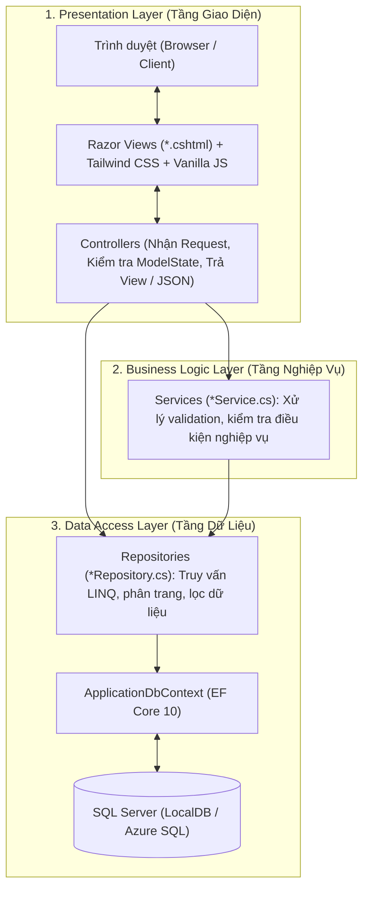
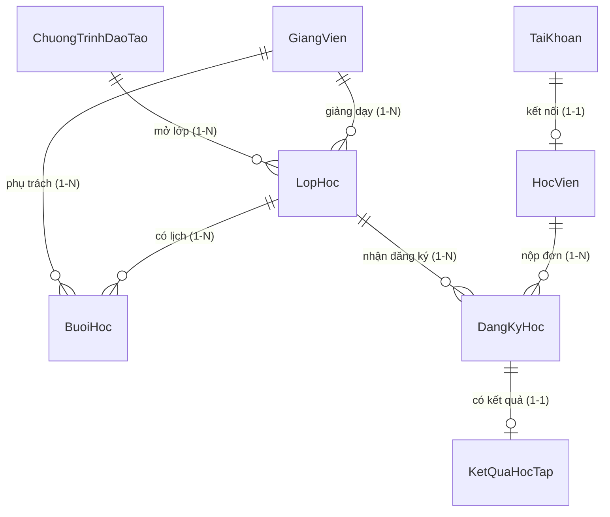

# 🎓 HỆ THỐNG QUẢN LÝ KHÓA HỌC & CỔNG ĐÀO TẠO THỰC HÀNH (EDUSPACE UNETI)

> **BÀI TẬP LỚN MÔN THỰC HÀNH LẬP TRÌNH .NET**  
> **TRƯỜNG ĐẠI HỌC KINH TẾ - KỸ THUẬT CÔNG NGHIỆP (UNETI)**  
> **KHOA CÔNG NGHỆ THÔNG TIN** — Lớp: **DHTI17A1HN** — Nhóm: **UNETI 4 (Nhóm 4)**  

[](https://dotnet.microsoft.com/)
[](https://learn.microsoft.com/aspnet/core)
[](https://learn.microsoft.com/ef/core)
[](https://www.microsoft.com/sql-server)
[](https://tailwindcss.com/)
[](https://vietqr.net/)

---

## 👥 1. BẢNG PHÂN CÔNG THÀNH VIÊN & NHIỆM VỤ CHI TIẾT

Dự án được phân chia thành **5 Module độc lập** theo cấu trúc **Repository Pattern**, bảo đảm mỗi thành viên phụ trách một khối nghiệp vụ riêng biệt, không đè code lên nhau:

| STT | Họ và tên | Mã sinh viên | Vai trò | Module phụ trách | Các File Repository & Service quản lý |
| :---: | :--- | :---: | :---: | :--- | :--- |
| **1** | **Vũ Đình Trường** | `23103100026` | **Nhóm trưởng** | **Module 1**: Quản trị Hệ thống, Tài khoản, Phân quyền & Chương trình đào tạo | `ITaiKhoanRepository.cs`, `TaiKhoanRepository.cs`<br>`ITaiKhoanService.cs`, `TaiKhoanService.cs`<br>`IChuongTrinhDaoTaoRepository.cs`, `ChuongTrinhDaoTaoRepository.cs`<br>`IChuongTrinhDaoTaoService.cs`, `ChuongTrinhDaoTaoService.cs` |
| **2** | **Nguyễn Đình Kiên** | `23103100020` | Thành viên | **Module 2**: Quản lý Lớp học & Đội ngũ Giảng viên | `ILopHocRepository.cs`, `LopHocRepository.cs`<br>`ILopHocService.cs`, `LopHocService.cs`<br>`IGiangVienRepository.cs`, `GiangVienRepository.cs`<br>`IGiangVienService.cs`, `GiangVienService.cs` |
| **3** | **Nguyễn Đức Linh** | `23103100042` | Thành viên | **Module 3**: Quản lý Học viên, Hồ sơ sinh viên & Cổng dịch vụ học viên (Eduspace) | `IHocVienRepository.cs`, `HocVienRepository.cs`<br>`IHocVienService.cs`, `HocVienService.cs`<br>`CongHocVienController.cs` (Giao diện Không gian học tập) |
| **4** | **Nguyễn Hoàng Long** | `23103100046` | Thành viên | **Module 4**: Tiếp nhận đăng ký, Xét duyệt hồ sơ, Quản lý tài chính & Thu học phí VietQR | `IDangKyHocRepository.cs`, `DangKyHocRepository.cs`<br>`DangKyHocController.cs`<br>Quy trình thanh toán VietQR & Xác nhận học phí |
| **5** | **Nguyễn Tùng Dương** | `23103100003` | Thành viên | **Module 5**: Xếp Thời khóa biểu (TKB), Quản lý Kết quả học tập (Bảng điểm) & Thống kê | `IBuoiHocRepository.cs`, `BuoiHocRepository.cs`<br>`IKetQuaHocTapRepository.cs`, `KetQuaHocTapRepository.cs`<br>`IThongKeRepository.cs`, `ThongKeRepository.cs`<br>`BuoiHocController.cs`, `KetQuaHocTapController.cs` |

---

## 🏛️ 2. KIẾN TRÚC HỆ THỐNG & NGUYÊN TẮC THIẾT KẾ (REPOSITORY PATTERN)

Dự án áp dụng chặt chẽ mô hình **3 lớp (3-Tier)** kết hợp **Repository Pattern & Dependency Injection**.



### ⚠️ Quy tắc Vàng về Clean Code:
1. **Tuyệt đối không inject trực tiếp `ApplicationDbContext` vào Controller**:
   - Tất cả truy vấn `_context.Set<T>()`, `ToList()`, `Where()`, `Include()` phải đặt trong thư mục `Repositories/`.
   - Controller chỉ tiêm (Inject) `IRepository` hoặc `IService` qua Constructor.
2. **Dữ liệu thật 100%**:
   - Không fix cứng danh sách mẫu (hardcode) trong HTML/Razor. Mọi thông tin lớp học, bảng điểm, lịch học, học phí đều lấy từ CSDL qua Repository.
3. **Phân trang Server-side (LINQ `Skip` và `Take`)**:
   - Áp dụng phân trang ngay trên `IQueryable` trước khi gọi `ToListAsync()`, không kéo toàn bộ bảng về RAM rồi mới cắt trang.

---

## 🗄️ 3. MÔ HÌNH DỮ LIỆU & QUAN HỆ CSDL (8 THỰC THỂ)



### Chi tiết các thực thể chính:

1. **`TaiKhoan`** (Quản lý đăng nhập & phân quyền):
   - `MaTaiKhoan` (PK), `TenDangNhap`, `MatKhau` (mã hóa SHA256), `HoTen`, `Email`, `SoDienThoai`, `VaiTro` (`Admin`, `GiaoVu`, `HocVien`), `TrangThai` (Hoạt động / Khóa).
2. **`ChuongTrinhDaoTao`** (Danh mục khóa học):
   - `MaCTDT` (PK), `MaChuongTrinh`, `TenChuongTrinh`, `MoTa`, `SoTinChi`, `HocPhiGoc`, `HocPhiUuDai`, `ThoiLuongGio`, `TrinhDo` (Cơ bản, Nâng cao), `HinhThuc` (Online, Offline), `DeCuong`, `HinhAnh`.
3. **`GiangVien`** (Hồ sơ giảng viên):
   - `MaGiangVien` (PK), `MaGV`, `HoTen`, `Email`, `SoDienThoai`, `HocVi` (ThS, TS, PGS.TS), `ChuyenMon`, `DonViCongTac`, `HinhAnh`.
4. **`LopHoc`** (Lớp học theo chương trình):
   - `MaLopHoc` (PK), `MaLop`, `TenLop`, `MaCTDT` (FK), `MaGiangVien` (FK), `NgayMoDangKy`, `HanDangKy`, `NgayKhaiGiang`, `NgayKetThuc`, `SiSoToiDa`, `SiSoHienTai`, `HocPhi`, `PhongHoc`, `TrangThai`.
5. **`HocVien`** (Hồ sơ học viên):
   - `MaHocVien` (PK), `MaHV`, `MaTaiKhoan` (FK), `HoTen`, `NgaySinh`, `GioiTinh`, `Email`, `SoDienThoai`, `DiaChi`, `NgheNghiep`, `DonViCongTac`.
6. **`DangKyHoc`** (Đơn đăng ký & Quản lý thu học phí):
   - `MaDangKy` (PK), `MaHocVien` (FK), `MaLopHoc` (FK), `NgayDangKy`, `TrangThai` (`ChoDuyet`, `DaDuyet`, `TuChoi`, `DaHuy`), `TrangThaiHocPhi` (`ChuaDong`, `ChoXacNhan`, `DaDong`), `SoTienPhaiDong`, `SoTienDaDong`, `NgayDongHocPhi`, `PhuongThucThanhToan`, `GhiChu`.
7. **`BuoiHoc`** (Thời khóa biểu từng buổi học):
   - `MaBuoiHoc` (PK), `MaLopHoc` (FK), `ThuTrongTuan` (2..8), `NgayHoc`, `CaHoc` (1..5), `PhongHoc` (HA8, HA9, HA10, HA11), `MaGiangVien` (FK), `NoiDung`.
8. **`KetQuaHocTap`** (Bảng điểm & Đánh giá kết quả):
   - `MaKetQua` (PK), `MaDangKy` (FK), `DiemChuyenCan` (trọng số 40%), `DiemCuoiKhoa` (trọng số 60%), `DiemTongKet` (Hệ 10), `DiemChu` (A, B+, B, C+, C, D, F), `DiemHe4`, `XepLoai` (Xuất sắc, Giỏi, Khá, Trung bình, Yếu), `TrangThai` (Đạt, Học lại).

---

## ⚡ 4. CÁC QUY TRÌNH NGHIỆP VỤ TRỌNG TÂM

### 💳 A. Quy trình Đăng ký & Đóng học phí VietQR (Module 3 & Module 4)
Quy trình đảm bảo kiểm soát tài chính minh bạch, chuẩn ngân hàng:
1. **Học viên nộp đơn đăng ký**:
   - Chọn khóa học phù hợp -> Bấm "Đăng ký".
   - Đơn ghi nhận với trạng thái `ChoDuyet`, học phí `ChuaDong`.
2. **Giáo vụ xét duyệt đơn**:
   - Kiểm tra điều kiện sĩ số lớp (`SiSoHienTai < SiSoToiDa`).
   - Duyệt đơn -> Trạng thái chuyển thành `DaDuyet`.
3. **Thanh toán học phí VietQR**:
   - Tại tab "Đơn đăng ký", học viên bấm **"Đóng học phí (VietQR / CK)"**.
   - Modal hiển thị **Mã QR động VietQR** chuẩn Napas 24/7 của Ngân hàng **MB Bank** (STK: `0381000556688`).
   - Mã QR tự động điền sẵn số tiền học phí và cú pháp chuyển tiền chuẩn: `[Mã Lớp] [Họ tên] [SĐT]`.
4. **Học viên xác nhận chuyển khoản**:
   - Sau khi chuyển qua App Ngân hàng, học viên bấm nút **"Xác nhận đã chuyển"**.
   - Trạng thái học phí cập nhật sang **`ChoXacNhan`** (Chờ giáo vụ đối soát).
5. **Giáo vụ phê duyệt & Kích hoạt lớp học**:
   - Phía Quản lý / Giáo vụ nhận được thông báo học viên đã nộp học phí, đối soát sao kê tài khoản ngân hàng.
   - Giáo vụ bấm **"Xác nhận đã nộp học phí"**.
   - Trạng thái đơn chuyển sang **`DaDong`**, tự động tăng `SiSoHienTai` của lớp.
   - Lớp học được mở khóa, học viên chính thức truy cập không gian học tập, xem tài liệu và lịch học.

---

### 📊 B. Bảng điểm Học phần Đơn nhất & Tính điểm Chuẩn (Module 5)
Bảng điểm được thiết kế chuyên nghiệp, loại bỏ chia học kỳ giả định, lấy **100% dữ liệu thật từ database**:
- **Công thức tính điểm**:
  $$\text{Điểm Tổng Kết} = (\text{Điểm Quá Trình} \times 0.4) + (\text{Điểm Cuối Khóa} \times 0.6)$$
- **Thang điểm chuẩn 4 & Quy đổi Điểm Chữ**:
  - $\ge 8.5$: Loại **A** (Hệ 4: 4.0) — *Xuất sắc*
  - $7.8 - 8.4$: Loại **B+** (Hệ 4: 3.5) — *Giỏi*
  - $7.0 - 7.7$: Loại **B** (Hệ 4: 3.0) — *Khá*
  - $6.3 - 6.9$: Loại **C+** (Hệ 4: 2.5) — *Trung bình khá*
  - $5.5 - 6.2$: Loại **C** (Hệ 4: 2.0) — *Trung bình*
  - $4.8 - 5.4$: Loại **D+** (Hệ 4: 1.5) — *Trung bình yếu*
  - $4.0 - 4.7$: Loại **D** (Hệ 4: 1.0) — *Đạt*
  - $< 4.0$: Loại **F** (Hệ 4: 0.0) — *Cần học lại*
- **Tính năng UI nâng cao**:
  - **Bộ lọc trạng thái**: Tất cả, Đang học, Đã hoàn thành (Đạt), Cần lưu ý / Nợ HP.
  - **Tìm kiếm thông minh tích hợp Autocomplete**: Gõ tên môn hoặc tên giảng viên sẽ hiển thị danh sách gợi ý rơi xuống (dropdown) để chọn nhanh.
  - **Drawer xem chi tiết thành phần điểm**: Xem chi tiết trọng số, điểm từng cột và tình trạng học phí.

---

### 📅 C. Ma trận Thời khóa biểu & Thuật toán Chống trùng lịch (Module 5)
- **Ma trận 7 ngày trong tuần**: Thứ 2 đến Chủ nhật với 5 ca học linh hoạt.
- **Giảng đường chuẩn UNETI**: Khu phòng học HA8, HA9, HA10, HA11.
- **Thuật toán LINQ kiểm tra trùng lịch (Overlap Check)**:
  ```csharp
  // Kiểm tra trùng phòng học
  bool biTrungPhong = await _context.BuoiHocs.AnyAsync(b =>
      b.MaBuoiHoc != buoiHocMoi.MaBuoiHoc &&
      b.NgayHoc == buoiHocMoi.NgayHoc &&
      b.CaHoc == buoiHocMoi.CaHoc &&
      b.PhongHoc == buoiHocMoi.PhongHoc);

  // Kiểm tra trùng lịch giảng viên
  bool biTrungGiangVien = await _context.BuoiHocs.AnyAsync(b =>
      b.MaBuoiHoc != buoiHocMoi.MaBuoiHoc &&
      b.NgayHoc == buoiHocMoi.NgayHoc &&
      b.CaHoc == buoiHocMoi.CaHoc &&
      b.MaGiangVien == buoiHocMoi.MaGiangVien);
  ```

---

## 🛠️ 5. HƯỚNG DẪN CÀI ĐẶT & CHẠY DỰ ÁN

### Yêu cầu môi trường:
- [.NET 10.0 SDK](https://dotnet.microsoft.com/download/dotnet/10.0)
- [Visual Studio 2022](https://visualstudio.microsoft.com/) (Bản 17.12 trở lên) với workload **ASP.NET and web development**
- SQL Server (LocalDB hoặc SQL Server 2019/2022)

### Các bước thực hiện:

#### Cách 1: Sử dụng Visual Studio 2022 (Khuyên dùng)
1. Mở file giải pháp: `QuanLyKhoaHoc_UNETI4_DHTI17A1HN.slnx`.
2. Mở cửa sổ **Package Manager Console** (`Tools` -> `NuGet Package Manager` -> `Package Manager Console`).
3. Chạy lệnh tạo CSDL:
   ```powershell
   Update-Database
   ```
4. Bấm `F5` hoặc nút `Run (https / http)` để khởi chạy ứng dụng.
5. Truy cập trình duyệt tại: `http://localhost:5155` hoặc `https://localhost:7155`.

#### Cách 2: Sử dụng .NET CLI (Terminal / PowerShell)
```powershell
# Di chuyển vào thư mục chứa project
cd QuanLyKhoaHoc_UNETI4_DHTI17A1HN

# Khôi phục dependencies
dotnet restore

# Cập nhật cơ sở dữ liệu
dotnet ef database update

# Khởi chạy dự án
dotnet run
```

> **Ghi chú về Dữ liệu Mẫu (Seed Data)**:  
> Hệ thống tích hợp `DbSeeder.SeedMockData()`, khi khởi chạy ứng dụng lần đầu sẽ tự động nạp đầy đủ các chương trình đào tạo, giảng viên, lớp học, tài khoản test, buổi học và kết quả học tập để kiểm thử ngay lập tức.

---

## 🔑 6. DANH SÁCH TÀI KHOẢN TRUY CẬP HỆ THỐNG

| Tài khoản (Username) | Mật khẩu | Vai trò (Role) | Chức năng kiểm thử chính |
| :--- | :--- | :--- | :--- |
| **`admin`** | `123456` | **Admin** | Quản trị toàn bộ danh mục, tài khoản, cấu hình hệ thống |
| **`giaovu`** | `123456` | **GiaoVu** | Mở lớp học, duyệt đơn đăng ký, xác nhận nộp học phí, xếp TKB, nhập điểm |
| **`hocvien`** | `123456` | **HocVien** | Tài khoản học viên mẫu: Đăng ký lớp, thanh toán VietQR, xem TKB & bảng điểm |
| **`nguyenvanan`** | `123456` | **HocVien** | Học viên có dữ liệu bảng điểm đầy đủ, lịch học và đơn đăng ký thực tế |
| **`gv_lephuoc`** | `123456` | **GiangVien** | Giảng viên: Xem lịch dạy theo tuần, danh sách sinh viên lớp phụ trách |

---

## 🌿 7. QUY TẮC PHÂN NHÁNH GIT & LÀM VIỆC NHÓM

### Danh sách các nhánh chính thức:
- **`main`**: Nhánh nguồn chính dùng để nộp bài và demo bảo vệ trước hội đồng.
- **`feature/module-1-truong`**: Nhánh phát triển của Vũ Đình Trường.
- **`feature/module-2-kien`**: Nhánh phát triển của Nguyễn Đình Kiên.
- **`feature/module-3-linh`**: Nhánh phát triển của Nguyễn Đức Linh.
- **`feature/module-4-long`**: Nhánh phát triển của Nguyễn Hoàng Long.
- **`feature/module-5-duong`**: Nhánh phát triển của Nguyễn Tùng Dương.

### Quy định đặt thông điệp Commit (Bắt buộc theo môn học):
```text
[Mã SV] [Module X] Tóm tắt nội dung công việc thực hiện
```
*Ví dụ:*
- `[23103100026] [Module 1] Hoan thien Repository phan quyen va xac thuc Cookie Claims`
- `[23103100020] [Module 2] Viet service phan trang LINQ Skip Take va loc giang vien`
- `[23103100042] [Module 3] Toi uu giao dien Cong Hoc Vien Eduspace va autocomplete tim kiem`
- `[23103100046] [Module 4] Hoan thien quy trinh thanh toan VietQR MB Bank va xac nhan hoc phi`
- `[23103100003] [Module 5] Tinh diem trung binh he 10 he 4 va thuat toan kiem tra trung lich`

---

## 🎓 8. BỘ CÂU HỎI VẤN ĐÁP BẢO VỆ BÀI TẬP LỚN CHO 5 THÀNH VIÊN

Bộ câu hỏi chuẩn sát thực tế chấm điểm của các Thầy/Cô Khoa CNTT - UNETI:

### 🔹 Sinh viên 1: Vũ Đình Trường (23103100026 - Module 1)
1. **Câu hỏi:** *Cơ chế xác thực của hệ thống sử dụng gì? Khác biệt giữa Session và Cookie Authentication với Claims?*  
   **Trả lời:** Hệ thống sử dụng Cookie Authentication kết hợp Claims. Khi đăng nhập thành công qua `ITaiKhoanService.KiemTraDangNhapAsync()`, hệ thống tạo `ClaimsIdentity` chứa `NameIdentifier` (ID), `Name` (Họ tên), `Role` (`Admin`, `GiaoVu`, `HocVien`) và ghi vào cookie bảo mật HTTP-Only. Đồng thời dùng Session để lưu trữ thông tin hiển thị nhanh trên Header.
2. **Câu hỏi:** *Chỉ ra vị trí code kiểm tra quyền truy cập không cho người dùng gõ thẳng URL vào trang Admin?*  
   **Trả lời:** Sử dụng thuộc tính `[Authorize(Roles = "Admin,GiaoVu")]` trên đầu `AdminController` và `ChuongTrinhDaoTaoController`. Nếu người dùng chưa đăng nhập, hệ thống tự động redirect về `/TaiKhoan/DangNhap`. Nếu sai quyền sẽ dẫn tới `/Home/AccessDenied`.

### 🔹 Sinh viên 2: Nguyễn Đình Kiên (23103100020 - Module 2)
1. **Câu hỏi:** *Tại sao trong `LopHocRepository` phải dùng `Skip()` và `Take()` trước khi gọi `ToListAsync()`?*  
   **Trả lời:** Dùng `Skip((pageIndex - 1) * pageSize).Take(pageSize)` trên `IQueryable` để Entity Framework sinh ra câu lệnh SQL có mệnh đề `OFFSET ... ROWS FETCH NEXT ... ROWS ONLY`. Dữ liệu chỉ được kéo đúng số bản ghi của trang đó từ Database về RAM, tối ưu tốc độ và không gây tràn bộ nhớ khi dữ liệu lớn.
2. **Câu hỏi:** *Khi người dùng tìm kiếm và lọc dữ liệu, làm thế nào để khi bấm sang trang 2, trang 3 không bị mất bộ lọc?*  
   **Trả lời:** Trên Razor View, các thẻ phân trang truyền kèm query string: `asp-route-keyword="@ViewBag.Keyword"`, `asp-route-trangThai="@ViewBag.TrangThai"`, `asp-route-maGiangVien="@ViewBag.MaGiangVien"`, nhờ đó giữ nguyên trạng thái tìm kiếm qua từng trang.

### 🔹 Sinh viên 3: Nguyễn Đức Linh (23103100042 - Module 3)
1. **Câu hỏi:** *Khi học viên bấm nộp hồ sơ đăng ký lớp học, hệ thống thực hiện kiểm tra những điều kiện gì?*  
   **Trả lời:** Trong `IHocVienService.DangKyLopAsync()`, hệ thống kiểm tra 4 điều kiện qua LINQ:
   - Học viên có tồn tại và đang hoạt động hay không.
   - Lớp học có đang ở trạng thái "Đang mở đăng ký" và thời điểm hiện tại `<= HanDangKy`.
   - Sĩ số lớp hiện tại có còn chỗ không (`SiSoHienTai < SiSoToiDa`).
   - Học viên đã có đơn đăng ký lớp này ở trạng thái `ChoDuyet` hoặc `DaDuyet` chưa (chống spam đăng ký trùng lặp).
2. **Câu hỏi:** *Tính năng tìm kiếm gợi ý tự động (Autocomplete) tại Cổng học viên được hiện thực như thế nào?*  
   **Trả lời:** Sử dụng hàm JavaScript `searchGradeSubjects()` lắng nghe sự kiện `input`. Dữ liệu danh sách môn học được quét từ các dòng bảng điểm thực tế, hiển thị gợi ý tức thì dưới thanh tìm kiếm. Khi bấm vào gợi ý, hệ thống tự động cuộn đến môn học và làm nổi bật (highlight).

### 🔹 Sinh viên 4: Nguyễn Hoàng Long (23103100046 - Module 4)
1. **Câu hỏi:** *Quy trình đóng học phí bằng VietQR diễn ra thế nào? Làm sao để tránh việc học viên chưa chuyển tiền mà đã được vào học?*  
   **Trả lời:** Khi học viên mở thanh toán, hệ thống sinh mã VietQR động theo định dạng Napas 24/7 với tài khoản MB Bank và số tiền chính xác của lớp. Sau khi chuyển, học viên bấm "Xác nhận đã chuyển" thì trạng thái chỉ là `ChoXacNhan`. Chỉ khi Giáo vụ kiểm tra tiền đã vào tài khoản và bấm "Xác nhận đã nộp học phí" trên trang quản lý của Giáo vụ thì trạng thái mới chuyển thành `DaDong` và kích hoạt quyền vào lớp.
2. **Câu hỏi:** *Viết câu lệnh LINQ kiểm tra số học viên đã nộp học phí của lớp để chốt danh sách?*  
   **Trả lời:** Trong `IDangKyHocRepository`:
   ```csharp
   int siSoDaNopTien = await _context.DangKyHocs
       .CountAsync(d => d.MaLopHoc == maLop && d.TrangThaiHocPhi == "DaDong");
   ```

### 🔹 Sinh viên 5: Nguyễn Tùng Dương (23103100003 - Module 5)
1. **Câu hỏi:** *Trình bày thuật toán kiểm tra xung đột thời khóa biểu khi xếp lịch học mới?*  
   **Trả lời:** Trong `BuoiHocRepository`, thuật toán kiểm tra 3 điều kiện trùng: Trùng phòng học (`PhongHoc`), trùng giảng viên (`MaGiangVien`), và trùng lớp học (`MaLopHoc`) trong cùng một `NgayHoc` và `CaHoc`. Nếu tồn tại bất kỳ bản ghi nào thỏa mãn điều kiện đó (khác với mã buổi học đang cập nhật), hàm sẽ trả về `false` và thông báo lỗi cụ thể.
2. **Câu hỏi:** *Công thức tính điểm trung bình tích lũy toàn khóa (GPA) theo thang điểm 10 và thang điểm 4 được thực hiện thế nào trong Repository?*  
   **Trả lời:** Hệ thống lấy tất cả bản ghi từ bảng `KetQuaHocTap` kết hợp với bảng `LopHoc` và `ChuongTrinhDaoTao` để lấy số tín chỉ:
   $$\text{GPA}_{10} = \frac{\sum (\text{DiemTongKet} \times \text{SoTinChi})}{\sum \text{SoTinChi}}$$
   $$\text{GPA}_{4} = \frac{\sum (\text{DiemHe4} \times \text{SoTinChi})}{\sum \text{SoTinChi}}$$
   Các môn có điểm F không tính vào tín chỉ tích lũy đạt nhưng vẫn được ghi nhận trong bảng điểm để theo dõi nợ học phần.

---

## 🏆 9. TỔNG KẾT & CAM KẾT ĐỒNG BỘ DỰ ÁN

- **Kiến trúc đồng bộ:** 100% tuân thủ Repository Pattern, không pha tạp truy vấn DbContext vào tầng Controller.
- **Giao diện hiện đại:** Chuẩn Responsive, Tailwind CSS với phối màu Indigo / Slate chuyên nghiệp, tối ưu trải nghiệm học viên và giáo vụ.
- **Toàn vẹn CSDL:** Tích hợp bộ Seed Data mẫu hoàn chỉnh, đảm bảo mở máy lên là chạy trơn tru mà không cần cấu hình thủ công.
